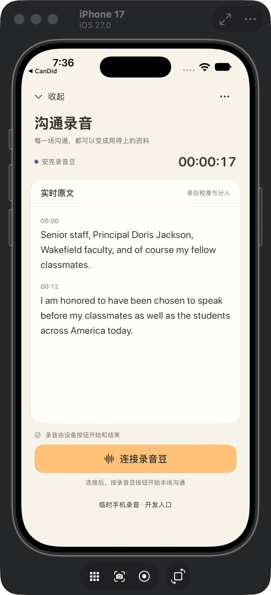

# 流式字幕详细诊断与修复计划（2026-10-14）

本次用户明确授权详细测试，覆盖真实供应商调用、后端 WebSocket、SwiftUI 页面及针对性回归。此前不运行软件测试的限制不适用于本次。使用同一段公开的 17.645125 秒 PCM16 音频、同一北京地域模型 `qwen-audio-3.1-asr-flash-streaming`，按实时速度发送，没有采集私人音频。

## 结论

1. 本机字幕通路有两个确定的阻断问题：缺少 WebSocket 服务端依赖，以及 `RecognitionCallback` 未导入。它们导致连接无法升级，或升级成功后服务端异常退出；不是正常识别后页面慢几秒。
2. 当前代理规则没有把阿里云请求转发到海外节点。Clash TUN 虽接管流量，但实测 ASR 连接命中 `DomainSuffix aliyuncs.com`，链包含 `DIRECT`。不显式设置代理与显式通过 HTTP 代理入口的三轮对照均正常。
3. 隔离环境仅补导入后，后端和真实 SwiftUI 页面均能显示完整实时识别结果。转发与页面观察更新是毫秒级。
4. 旧记录中停止后 11.394/18.099 秒才完成的长尾，本轮未复现，包括使用旧请求原始参数的对照。不能追溯断言当时是代理或模型负载导致。

## 确定故障及复现

### A. WebSocket 服务端依赖缺失

原后端日志 `/tmp/candid-recording-native-backend.log` 有两次 `Unsupported upgrade request`、`No supported WebSocket library detected`。基础 `uvicorn` 不包含可用的服务端 WebSocket 协议实现；安装的 `websocket-client` 是出站客户端，不能替代该依赖。

上轮已经在本机增加 `wsproto>=1.2,<2`（安装 1.3.2），并在 `run.py` 指定 `ws='wsproto'`。本轮实际握手证明升级已成功，不再只依据 HTTP 健康检查。

### B. 实时路由使用了未导入的 RecognitionCallback

正式后端实际接入 `/v1/speech/live` 后，在定义 `class Callback(RecognitionCallback)` 时抛出：

```
NameError: name 'RecognitionCallback' is not defined
```

它位于该路由的 try 块之前，未转成约定的 error 事件。App 只能看到断开，等待 2 秒后重连。HTTP `/health` 返回 200 无法覆盖这个问题。

原样回归稳定复现；隔离后端注入这一导入后，鉴权、逐帧转写、最终字幕、结束事件及坏帧处理全部通过。正式 `backend/app.py` 本轮没有修改，修复仍列在 P0 计划中。

## 代理核实

- macOS 系统 HTTP、HTTPS、SOCKS 代理均为 `127.0.0.1:7897`。
- Clash 为 rule 模式且开启 TUN；系统 DNS 返回 `198.18.0.200`，路由为 `utun6`。
- 因此关闭客户端显式代理不能等价于物理绕过 TUN。本轮未修改系统或 Clash 配置。
- SDK 的 aiohttp `trust_env=True` 对当前 `wss` URL 未取到显式环境代理，但 socket 仍经 TUN。
- 通过 Clash 本机 Unix controller 只读查询，实际 ASR 连接命中 `aliyuncs.com` 的 DIRECT 链，没有海外节点。控制器 secret 未输出或保存到报告。
- HTTP 无授权请求的 TLS/首字节对照约为：TUN 入口 171/253 毫秒，HTTP 代理入口 150/215 毫秒。该请求返回预期的 401，只用于网络建立时延，不算 ASR 识别结果。

这组对照比较的是同一 DIRECT 策略下的两种入口，不是“物理停用 TUN”和“强制海外代理”的对照。它证明当前请求没有海外绕路，不能证明旧时刻配置也相同。

## 实测结果

| 试验 | 重复次数 | 首个非空文字，距首包实际发送 | 停止后完成 |
| --- | ---: | ---: | ---: |
| 原生协议，TUN 入口按规则直出 | 3 | 0.541–0.640 秒 | 0.421–1.465 秒 |
| 原生协议，HTTP 代理入口按规则直出 | 3 | 0.557–0.638 秒 | 1.024–1.290 秒 |
| 官方 SDK，VAD 模式 | 1 | 0.764 秒 | 0.540 秒 |
| 官方 SDK，语义分句 | 1 | 0.853 秒 | 1.312 秒 |
| 原生协议，语义分句 | 1 | 0.703 秒 | 0.423 秒 |
| 与旧记录相同的请求参数 | 1 | 0.562 秒 | 0.571 秒 |
| 补导入的隔离后端，当前生产参数 | 2 | 客户端开始发送后 1.413–2.004 秒 | 0.607–0.687 秒 |

后端 ready 在 SDK 启动函数返回后发出，并不代表阿里云握手完成。第二次后端精细计时显示：第一帧进入 SDK 后约 396 毫秒才实际上网，之后约 1.015 秒收到首个非空文字。因此后端行包含连接建立，不能直接与“已握手后再发音频”的原生协议行比较。

SDK 对发送生成器使用同步轮询，200 毫秒分块时其网络事件循环出现约 213 毫秒最大调度间隔。它是可测的额外粒度，不能解释旧记录十余秒长尾。首包发送耗时在本轮各请求中最大约 3.8 毫秒，没有观察到本地发送队列的数秒阻塞。

两次隔离后端共 44 个回调：

- SDK 回调到后端发送：中位数 0.170 毫秒，最大 0.468 毫秒。
- 后端发送到本机 Python 客户端接收：中位数 0.449 毫秒，最大 0.880 毫秒。

### 真实 SwiftUI 页面

使用单独 bundle id 的诊断版 App，源码来自当前 App 的副本。保留真实 `SpeechController.openLive`、`sendFrame`、WebSocket 接收逻辑及 `LiveRecordingView`，仅用公开样本代替麦克风输入并添加时间记录；生产 iOS 源码没有修改。后端为已补导入的隔离环境。

22 次字幕接收对应 22 次页面观察更新，接收至 SwiftUI onChange 的中位数为 8.038 毫秒，最大 41.839 毫秒。截图确认完整识别结果已经显示。此指标是 SwiftUI 观察更新时刻，不是 GPU 像素呈现时刻；也不是麦克风或安克蓝牙实测。



## 回归与证据

- 现有 ASR 输入/协议测试：18 项通过。
- 定向 WebSocket 回归：6 项通过，包含原始缺导入故障复现，以及隔离修复后的未授权、乱序帧、错误 Base64、奇数字节、临时/最终字幕和 finished 顺序。
- 本次共 13 份协议/后端请求记录，其中 1 份正式后端在调用模型前失败；另有 1 次真实原生页面识别。成功的供应商音频请求共 13 次，发送公开音频合计约 229 秒，不将此数字作为账单。
- 诊断副本 iOS 编译成功；没有声称真机、蓝牙设备、长会议、混合方言或整体软件验收通过。
- 机器可读结果、逐事件时间、测试输出、原生截图位于 `docs/asr-latency-20261014/`。临时诊断源码位于 `/tmp/candid-asr-diagnose-20261014/`；没有将任何 API key、访问令牌或代理凭据写入证据。

## 修复计划（历史诊断时版本）

执行顺序已与主页语音交互合并到 [统一计划](VOICE_CONVERSATION_PLAN.md)。下面的 P0/P1/P2 保留为问题来源，实施时以统一计划及其审核修订为准。

### P0：让当前字幕入口真正可用

1. 在正式后端显式导入 `RecognitionCallback`；将回调定义/初始化纳入错误处理，异常转为可识别的连接错误，避免 App 反复空重连。
2. 保留并提交 `wsproto` 依赖及明确的 Uvicorn 协议配置。将 WebSocket 握手与 ready/partial/final/finished 的回归纳入项目，不能仅用 `/health` 验收。
3. 用正式后端、当前模型和公开样本重新验证完整原生字幕路径，确认最终文本没有丢失，随后按需要提交推送。

### P1：消除启动与断线时的等待和缺字

1. 把“本机通道已接通”和“上游已就绪”区分；只在确认阿里云 task-started 后标记上游就绪。
2. 采集开始至上游就绪期间保留小容量的有序音频缓冲。目前 ready 前的音频直接跳过，可能丢掉开头，不能只用更快的连接掩盖它。
3. 为鉴权/配置失败提供明确错误和停止重试；为临时网络问题设置限次退避和可手动恢复入口，保留完整文件。

### P2：将未来长尾定位到具体一跳

1. 加入不含音频正文和凭据的耗时记录：采集、入队、实际上网、供应商回调、后端发送、App 接收、页面观察更新；同时记录队列积压、丢帧、重连次数。
2. 网络对照记录 TUN、命中规则与 DIRECT/代理路径。后期 AWS 部署需重新测量地域和实际出口，不照搬本机结果。
3. 使用相同音频和时间基准验收，再考虑将实时分块统一为官方建议的约 100 毫秒，或替换 SDK 中阻塞生成器的传输实现；先证明收益，再改生产路径。

当前不更换模型、不改变代理全局策略、不调低 VAD。语义分句/VAD 的单次对照不足以支持“换参数即可解决”的结论。历史长尾尚无可归属的根因，后续若再发生，P2 的记录能区分客户端积压、网络与上游返回慢。

官方参数依据：[Qwen-Audio-ASR-Streaming Python SDK](https://www.alibabacloud.com/help/en/model-studio/qwen-audio-asr-streaming-python-sdk)。文档说明语义分句与 VAD 的选择及约 100 毫秒音频帧建议；本轮没有据此自动改参数。
