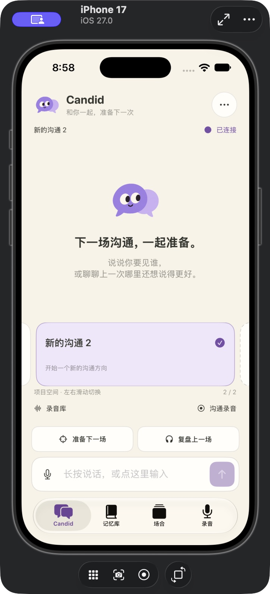
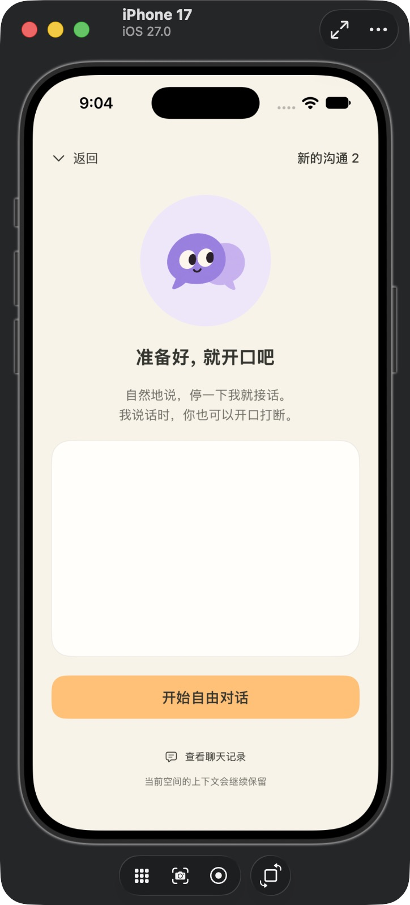

# 字幕修复与主页语音实施记录

2026-10-14。统一计划的阶段 1–6 已实现 Debug 内部版；阶段 7 的离线软件回归已通过，真机和真实模型验收待完成。本次更新通过 master 交付，具体提交以 Git 历史为准。本文记录实际交付范围，不把编译成功写成端到端语音验收。

## 新增交互

- 非编辑态长按主页输入框说话，松开后等待完整最终转写并自动发送；上滑取消。编辑态保留系统选字，麦克风按钮支持等效操作。原打字草稿不被语音清空。
- 双击左上角头像，或通过菜单/辅助功能进入连续对话。沿用米白、紫色、圆角风格，显示当前空间、用户字幕、回答和状态，提供暂停/继续、切文字、结束及聊天记录。
- 本机 WebRTC VAD（16 kHz、20 ms、mode 2）判断人声；约 1 秒静音封口。消息提交前的补充使用新的 ASR 子段，仍合并为同一逻辑输入；提交之后另起一轮。
- 人声候选先暂停旧声音，持续有效人声再停止旧播放并异步取消该语音轮。未确认候选消失后可恢复播放。旧 generation 的音频不会进入新队列。200 ms 仅是开发目标，尚无真机测量。
- 后台、系统打断、音频设备变化及切空间会停止/暂停收音；回前台需点击继续。已提交消息仍归原空间。

连续模式在 Release 构建中关闭，保留 Debug 内部入口；通过真机回声/误打断门槛后再开放。它复用现有 Agent、SOUL、Skills、记忆和项目空间，没有新增端到端云语音模型。

## 字幕与音频链路

正式 Uvicorn 显式使用 wsproto，修复实时回调未导入问题。`/v1/speech/live` 交给独立 relay，ASR 使用 DashScope 公开 duplex 协议，真正收到 `task-started` 才 ready。没有修改全局代理、地域或当前模型；沿用语义分句，保留粤语原话设置。

App 的启动队列上限 10 秒/320 KB；就绪后待发送上限 2 秒/64 KB，启动存量逐步扣减。短语音和会议字幕均有启动缓冲、有序发送与结束等待。会议连接失败限次退避；完整会议文件继续走录后精转写，不把实时字幕缺段伪装成完整结果。

后端保护 final、complete、error 和 finished 的交付顺序；partial 可替换，关键队列溢出则明确失败。语音自动提交必须核对最终覆盖、字节数、序号和所有非空句的 final；失败保留输入，禁止 partial 自动发送。

采集与 PCM 播放放在同一个 AVAudioEngine 中，启用 iOS voiceChat 与 voice processing。语音、会议录音、历史播报和回听统一用唯一音频租约协调。真机外放回声消除的效果尚未验收。

## Agent 与播报

- `POST /v1/voice/turns` 复用现有任务和每对话排队规则，使用固定 request/input/session/generation 标识；发送结果不确定时先查回执，不自动再次调用模型。
- waiting_input 通过原任务的 input_id/attempt 回答；问题变化时保存输入。追问发布独立的已确定 prompt，不因用户回答而取消等待补充任务。
- 工具规划阶段不发布可播报正文；预留现有任务预算中的最终回答轮，禁用工具后才产生 committed speech。聊天中的最终文字与播报来自同一回答。
- `/v1/voice/output/{task_id}` 输出短句和 24 kHz PCM，按播放回执限制提前量。断线不自动重放。普通完整消息的手动 WAV 播报接口仍保留。
- 取消传播到文本响应及 TTS 连接；本机停声不等服务器 ACK。服务器取消未知时明确提示，不声称供应商已停止计算或退款。

## 恢复与计时

未提交语音保存在 App 私有、完整文件保护的 VoiceInputs 目录，不进入会议库；取消及确定发送后清理。失败输入按原空间/后端身份保留，最长 24 小时、总量 20 MB；启动和回前台清理。恢复转写由用户显式触发，结果回到可编辑草稿，不自动发话。未知提交回执不盲目重发。

后端 provider_runs 记录上网、就绪、回调、发送、队列峰值与用量；App VoiceTiming.jsonl 记录采集、ASR、提交、打断、TTS 接收和 SwiftUI 字幕观察事件，不保存密钥或正文。该观察事件不等于实际像素/扬声器呈现时刻，跨设备时钟不能直接相减。AWS 出口需重新测量；旧十余秒长尾仍没有可追溯根因。

## 证据与边界

- 最新 Debug 模拟器构建成功：`sh scripts/check-ios.sh --build`。摘要与机器记录在 [voice-native](voice-native/delivery.json)，完整本机日志 `/tmp/candid-voice-build-final.log`。
- 后端 Python 源码语法检查通过；后端新进程启动成功，health/capabilities/OpenAPI 均返回 200。只证明启动和路由注册，不证明供应商识别/播报成功。
- 原生 App 已安装启动并查看主页和连续对话页面。截图记录页面结构，不是麦克风、真实说话或全双工验证。
- 用户随后授权本轮软件测试：后端 82 项、iOS 7 项单元测试与 4 项 UI 测试全部通过，Debug 真机目标编译通过（未签名/安装）。软件回归使用本地替身与临时数据库；没有进行付费 ASR/TTS/文本验证或安克硬件联调。详见 [验证记录](voice-native/validation.json)。
- 本轮修复测试夹具的数据库/适配器不一致及改版前的录音 UI 路径；新增 ASR 协议就绪、最终结果顺序、幂等取消、追问、播报防重放、PCM 序号、音频租约与 VAD 分片回归。完成后的 Agent 被取消时也会终止仍在输出的 TTS。UI 测试显式阻止恢复真实后端连接。
- 固定依赖出处和许可证见 `ios/CanDid/VoiceActivity/PROVENANCE.md` 与 LICENSE。没有明文上传服务密钥。

测开仍需执行：长按/上滑与系统选字冲突、快速补充和 final 覆盖、三语混说、权限/断线/重启恢复、waiting_input、连续打断与迟到 ACK、后台/路由变化、空间隔离、文件清理，以及真机扬声器/耳机的回声和误打断。不能用旧 ASR 隔离诊断结果替代新代码验收。

